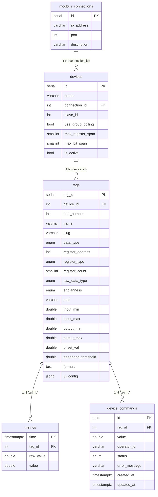

# Архитектура IIoT-системы

Технический справочник по устройству системы: сервисы, потоки данных, API, схема БД.
Для нетехнического обзора «что и зачем» см. [Обзор системы](Обзор%20системы.md);
описание модельного стенда — в [Устройства и теги](Устройства%20и%20теги.md).

---

## 1. Что это такое

SCADA-система для промышленного мониторинга и **диспетчерского управления**: собирает
показания с Modbus-устройств, хранит историю (TimescaleDB), отдаёт в реальном времени в
веб-админку и **позволяет записывать в оборудование** (уставки, реле) с аудитом команд.

Развёртывается через `docker compose`. Сервисы:

| Сервис | Стек | Роль |
|---|---|---|
| `sim` | Python + pymodbus | Симулятор Modbus TCP (модельный стенд) |
| `collector` (IIoT.Collector) | .NET Worker | Опрос устройств, пересчёт, запись в БД, исполнение команд |
| `db` | PostgreSQL + TimescaleDB | Хранилище конфигурации и временных рядов |
| `webapi` (IIoT.WebApi) | .NET (REST + SignalR) | API для админки + рассылка событий по WebSocket |
| `iiot_admin` | Nuxt 4 | АРМ инженера/оператора (мониторинг + управление) |

---

## 2. Общая схема

```
 ┌──────────────────────────────── Docker ────────────────────────────────┐
 │                                                                         │
 │  ┌───────────────┐   Modbus TCP   ┌──────────────────┐                  │
 │  │  Устройства   │◄──────опрос────│  IIoT.Collector  │                  │
 │  │  (sim:5020,   │───── запись ──►│  (Worker)        │                  │
 │  │   slave 1..3) │                └────────┬─────────┘                  │
 │  └───────────────┘                         │ SQL / LISTEN-NOTIFY        │
 │                                   ┌─────────▼──────────┐                 │
 │  ┌──────────────────┐   SQL +     │   PostgreSQL       │                 │
 │  │   IIoT.WebApi    │◄──NOTIFY────│   + TimescaleDB    │                 │
 │  │  REST + 2×SignalR│             └────────────────────┘                 │
 │  └────────┬─────────┘                                                    │
 └───────────┼─────────────────────────────────────────────────────────────┘
             │ HTTP (REST) + WebSocket (hubs/metrics, hubs/control)
       ┌─────▼──────┐
       │ iiot_admin │  (Nuxt 4: мониторинг + АРМ управления)
       └────────────┘
```

---

## 3. IIoT.Collector — сборщик данных

Подключается к устройствам по Modbus TCP, читает регистры, пересчитывает в физические
величины, фильтрует и пишет в БД. Также **исполняет команды управления** (запись в Coil/Holding).

**Параллельные циклы:**

| Цикл | Назначение |
|---|---|
| `RunDynamicPollingLoop` | Основной: каждые `polling_interval_ms` опрашивает активные устройства |
| `RunConfigLoop` | Резервный: периодически (`config_reload_interval_sec`) перечитывает конфиг из БД |
| `RunConfigListenerLoop` | Реактивный: мгновенно реагирует на `NOTIFY config_changed` |
| `RunHealthLoop` | Сердцебиение: пишет статус `ONLINE/DEGRADED/CRITICAL_ERROR` в `system_status` |
| `RunBufferFlusherLoop` | Буфер: при недоступности Postgres метрики копятся в локальный SQLite и досылаются |
| `RunCommandListenerLoop` | Управление: слушает новые `device_commands`, пишет в устройство, обновляет статус |

**Пул соединений.** Несколько устройств могут делить один сетевой сокет (`modbus_connections`).
Доступ к каждому соединению сериализуется семафором — одновременно с одним шлюзом работает
один запрос (Modbus TCP не терпит чересстрочных транзакций на одном соединении).

**Пересчёт raw → физика.** Линейная интерполяция (для `ANALOG_RAW`):

```
value = (raw − InputMin) / (InputMax − InputMin) × (OutputMax − OutputMin) + OutputMin + OffsetVal
```

Для `ANALOG_PHYSICAL` (FLOAT32/64) устройство уже отдаёт физическую величину — масштабирование
не применяется. `DIGITAL` — 0/1. Порядок байт многорегистровых значений задаётся `endianness`
(BIG/LITTLE_ENDIAN, WORD_SWAP, BYTE_WORD_SWAP).

**Deadband** — фильтр от дублей. Метрика сохраняется, если выполнено хотя бы одно:
- значение изменилось больше чем на `deadband_threshold`;
- прошло больше `data_heartbeat_sec` с последней записи (принудительное «жив»);
- для дискретных (0/1) — только при смене состояния.

---

## 4. Поток управления (supervisory control)

Запись в оборудование — асинхронная, с аудитом, через таблицу-очередь `device_commands`:

```
Оператор (админка) ─POST /api/v1/control/write─► WebApi ─INSERT device_commands(PENDING)─► БД
                                                                   │ NOTIFY command_status_changed
  Collector ◄──LISTEN──────────────────────────────────────────────┘
     │ PROCESSING → запись в Coil/Holding по Modbus → SUCCESS / FAILED (+ error_message)
     └─INSERT/UPDATE──► БД ─NOTIFY──► WebApi ─SignalR hubs/control─► админка (статус команды)
```

Записывать можно только теги с регистром **COIL** или **HOLDING_REGISTER** (на фронте — `isWritableTag`).
Жизненный цикл команды: `PENDING → PROCESSING → SUCCESS | FAILED`.

---

## 5. IIoT.WebApi — REST + SignalR

### REST-эндпоинты

| Метод | Путь | Описание |
|---|---|---|
| GET | `/api/devices` | Устройства (с `?limit=N` — для дашборда) |
| GET/POST/PUT/DELETE | `/api/devices[/{id}]` | CRUD устройств |
| GET/POST/PUT/DELETE | `/api/connections[/{id}]` | CRUD Modbus-соединений (`modbus_connections`) |
| GET | `/api/tags` | Все теги |
| GET | `/api/tags/{id}` | Тег по ID |
| GET | `/api/tags/device/{deviceId}` | Теги устройства |
| POST/PUT/DELETE | `/api/tags[/{id}]` | CRUD тегов (PUT — полная замена) |
| GET | `/api/metrics/history` | История (`?tagId=&from=&to=`), агрегация `time_bucket` |
| GET | `/api/metrics/latest` | Последнее значение по каждому тегу (снимок для UI) |
| POST | `/api/v1/control/write` | Команда записи в тег (202 Accepted, `device_commands`) |
| GET/PUT | `/api/system/config` | Глобальные настройки |
| GET | `/api/system/status` | Статус сервисов |

### История метрик: бакетирование

```
GET /api/metrics/history:
  duration = to − from
  источник = (duration > 48 ч) ? metrics_hourly : metrics
  бакет    = clamp(duration / ~500 точек, мин. шаг источника)
  SELECT time_bucket(бакет, time), AVG(value) ... GROUP BY 1 ORDER BY 1
```

Равномерная сетка по времени (график не «плывёт» при неравномерной плотности сырья) и
ограниченный объём ответа (~500 точек вместо десятков тысяч на сутки).

### Два канала SignalR

| Хаб | Назначение | События |
|---|---|---|
| `hubs/metrics` | Телеметрия + конфиг | `ReceiveMetrics(json)`, `ConfigUpdated(type, id)` где type ∈ `DEVICE`/`TAG`/`CONNECTION`, `SystemAlert(msg, level)` |
| `hubs/control` | Диспетчеризация | `CommandStatusChanged(json)` — обновления статусов команд |

WebApi-фоновые слушатели подписаны на Postgres-каналы `metrics_realtime`,
`config_changed`, `command_status_changed` и ретранслируют их в соответствующие хабы.

---

## 6. Схема БД (PostgreSQL + TimescaleDB)



**Прочие таблицы (без связей):**

| Таблица | Содержимое |
|---|---|
| `metrics_hourly` | Continuous aggregate: почасовые `avg/min/max` для графиков за длительный период |
| `system_config` | Одна строка: интервалы опроса/перечитывания, deadband, retention, heartbeat |
| `system_status` | Статус каждого сервиса: `service_name`, `status`, `uptime_seconds`, `last_error`, `last_sync` |

**Ключевое отличие vendor-agnostic схемы:** сетевой сокет вынесен в `modbus_connections` —
несколько устройств (`devices.slave_id`) делят один шлюз. Карта регистров тега
(`register_address`, `register_type`, `register_count`, `raw_data_type`, `endianness`) задаётся
в конфиге, поэтому система работает с любым Modbus TCP контроллером без правок кода.

---

## 7. Как подключить новый контроллер

1. Заведи **соединение** (`POST /api/connections`): `ip_address`, `port` (обычно 502).
2. Заведи **устройство** (`POST /api/devices`): привяжи `connectionId`, укажи `slaveId` (1–247).
3. Для каждого параметра заведи **тег** (`POST /api/tags`) по карте регистров из документации:
   `registerAddress`, `registerType`, `registerCount` (1 = 16-бит, 2 = 32-бит float),
   `rawDataType`, `endianness`, `inputMin/Max` → `outputMin/Max`, `unit`.
4. Collector подхватит конфиг через `NOTIFY` — перезапуск не нужен.

Подробный разбор типов регистров и пример стенда — в [Устройства и теги](Устройства%20и%20теги.md).
